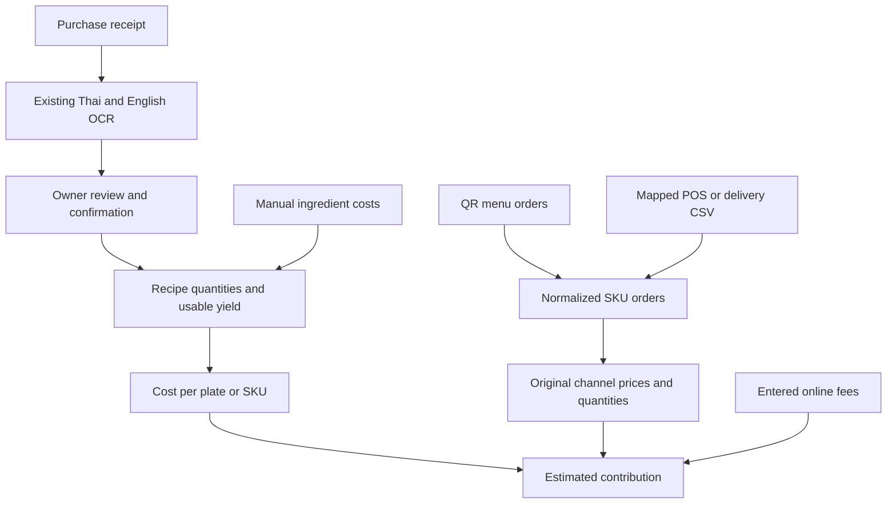
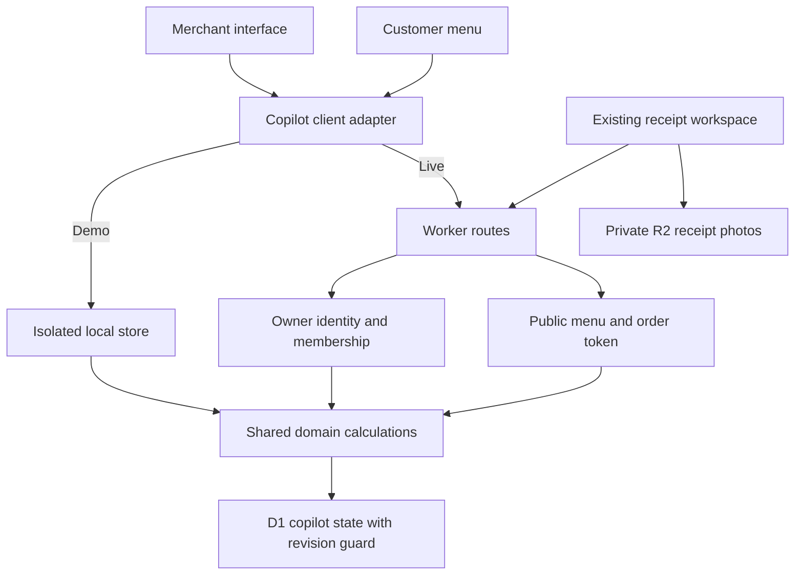

# Merchant copilot

The primary job is to connect purchased ingredients to recipe portions and SKU orders. Order coordination supports this calculation; no payment settlement or net-profit claim is made.

## Routes

- `/copilot`: owner-authenticated live merchant workspace.
- `/copilot/demo`: isolated, browser-local simulation with fictional purchases, recipes and orders. No provider calls.
- `/copilot/demo#order`: embedded made-to-order menu, table QR, basket, reviewed submission and order tracking. `/copilot#order` uses the live merchant menu and public QR submission route. The customer can also scan/open the standalone menu URL.
- `/copilot/demo#ai`: simulated receipt organization, ingredient normalization, stock review, fourteen-day comparison, adaptive prep illustration and evidence-based demo Advisor. `/copilot#ai` explains the unconnected feature and links to the demo; it never presents the simulation as live inference.
- `/menu?shop=PUBLIC_KEY&table=LABEL`: public customer menu and order tracking.
- `/menu/demo?shop=demo&table=LABEL`: simulated customer experience. Same-browser tabs share the demo; another device starts its own sample.
- Existing root, `/demo`, and Versions A/B/C remain intact.

## Calculation flow

Ingredient portion cost = purchase amount × portion quantity ÷ usable purchase quantity, rounded to satang. Recipe cost sums ingredient portions, packaging and entered variable costs. Contribution subtracts current recipe costs and entered channel fees from original non-cancelled order values. Open and served orders remain separate counts; neither proves payment. Unknown recipes or online fees stay unknown. Fixed overhead, tax and any unentered costs are excluded. Current estimates do not reconstruct historical net profit.

Receipts cannot reveal a recipe automatically. The merchant confirms units, usable quantity and portion size. The server resolves owned, confirmed purchase lines and derives their authoritative purchase amount rather than trusting a client-supplied receipt value.

## Application boundaries

`dist/copilot/domain.mjs` is the shared calculation and order model. `client.mjs` selects local simulation or live HTTP; it never silently substitutes demo data for an unavailable live service. `worker/copilot.mjs` enforces owner membership, confirmed receipt references, request bounds, public/private projections and optimistic concurrency. `0002_copilot.sql` adds a forward-only owner-linked state table.

Receipt OCR reuses the existing browser-local Thai/English Tesseract pipeline and private confirmation/archive flow. Gemini, RAG, candidate comparison, business memory and original commercial analytics remain in the linked Business Studio. The new queue/cost model is not yet supplied automatically to the existing Advisor corpus; no new model training is claimed.

## AI demonstration

Visible Order menu and AI demo shortcuts in the original A/B/C headers lead into the copilot. They retain the existing unsaved-work navigation guard. The demo receipt action opens the AI flow; real receipt OCR remains unchanged.

`ai-demo.mjs` owns pure, deterministic fictional records and calculations. `ai-view.mjs` presents them with the same visual theme. State and chat remain within the current demo page session; resetting the demo resets this context. This layer makes no Gemini, embedding, training or other provider requests. The proposed Gemini plus custom ingredient model is labelled as simulated, with training and live adaptation left for a later implementation.

- The sample receipt's Thai Buddhist date is normalized, chicken aliases and units are organized, and the merchant confirms the proposed fields before their costs enter the second week's calculation.
- The fixed 1–14 October 2026 fixture compares completed portions and estimated contribution for its first and second weeks. Purchases are shown separately from recipe-implied ingredient consumption. Cancelled portions do not contribute sales or costs; online fees are explicitly illustrative. Fixed overhead, taxes and unentered costs remain excluded.
- The demand control changes a deterministic suggested-prep rule, not recorded historical sales or trained weights. The historical comparison does not prove that a recommendation caused improvement.
- The current copilot demo service is separate context. QR orders and recipe edits update that context through the existing shared calculation model; they are not silently inserted into the fixed historical fixture. Open orders are not confirmed sales or payments.
- Advisor responses use the sample records, current assumptions and, when available, current demo service calculations. Unsupported questions request the missing information instead of inventing a diagnosis or food expiry.

Food storage is a **review reminder, not a verified expiry date**. Receipt dates establish neither the complete cold chain nor a product's safety. The example needs confirmed purchase fields and an explicit chilled-storage assumption before suggesting review. WHO supplies general safe-handling guidance; the ingredient-specific raw poultry range comes from the [FoodSafety.gov cold-storage chart](https://www.foodsafety.gov/food-safety-charts/cold-food-storage-charts), which lists 1–2 days at 4°C or below for home refrigeration. It is not a substitute for commercial procedures, package use-by labels, product history or merchant checks. The fourteen-day analysis window never becomes a meat shelf-life recommendation.

## Integration contract

QR is native. Manual orders and mapped CSV imports work in live mode. A CSV export from another system must contain `order_id,channel,table,sku,quantity`; `channel` is `offline` or `online`, and SKU IDs must match the merchant catalog. Saved catalog prices are used. This first adapter does not import historical external sale prices, refunds, discounts, settlement or platform fees. Stable IDs allow retries without duplicate orders; a partial import reports completed groups and can be retried safely.

Demo QR/POS/delivery buttons insert explicitly labelled, idempotent sample sources into the same model. They demonstrate a common adapter contract, not working vendor API integrations. Grab/POS live APIs require separate authorized connectors, SKU mapping, credential management and provider-specific verification. A configured Grab menu link opens Grab separately; the copilot does not override Grab's checkout or prices.

The embedded Order menu uses the same public menu projection and QR submission path as the standalone customer page. It does not iframe a second app or introduce a separate order store. A submitted order appears in Service and contributes to the SKU ledger after refresh. Customers choose at in-store prices and send to the kitchen. The server freezes order price snapshots and exposes only that order via a random tracking token. The merchant moves new → preparing → ready → served or cancels. Station/prep-time aggregation estimates the queue using configured parallel capacity. This is a heuristic, not a guaranteed ready time. QR ordering starts paused in live mode until the merchant reviews prices and enables it.

Payment remains outside this app. Payment-method labels are informational; no collection, refund, government-scheme enrollment, eligibility verification or payment reconciliation is implemented. Subscription revenue is a proposed business model; no price, billing or charges are implemented. Removing checkout is not a legal classification of the product.

## Boundaries and verification

Catalog: 1–60 SKUs. Orders: 20 lines / 50 units, 80 active and 500 retained. State: 900 KB; JSON requests: 40 KB. CSV: 50 KB / 100 data rows. These are explicit MVP bounds, not production-scale claims. Public ordering would need production abuse controls, operational monitoring and retention design before broad launch.

Meaningful automated checks cover owner isolation, concurrent mutations, duplicate retry, public projections, channel prices, queue estimates, recipe rounding, unknown costs/fees, receipt ownership, CSV parsing/partial retries, custom SKU validation and demo isolation. Source rendering covers EN/TH views. Browser visual, keyboard/touch and real merchant-photo OCR review remain separate verification tasks; source checks do not substitute for them.

Presentation reuses the generated mountain window and ivory/forest theme, with natural-scroll layered camera motion, a reversible warm-light Easter egg, staged section reveals, rounded panels and responsive layouts. Reduced-motion and transparency preferences are supported. No GitHub or Vercel changes are part of this Sites review build.
